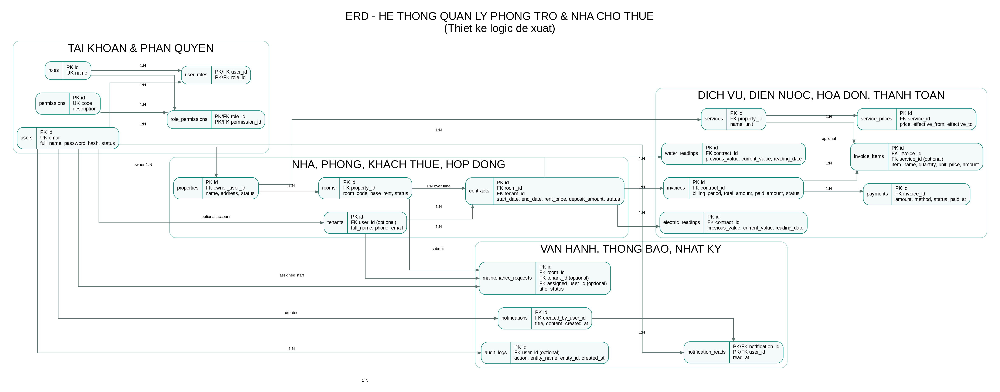
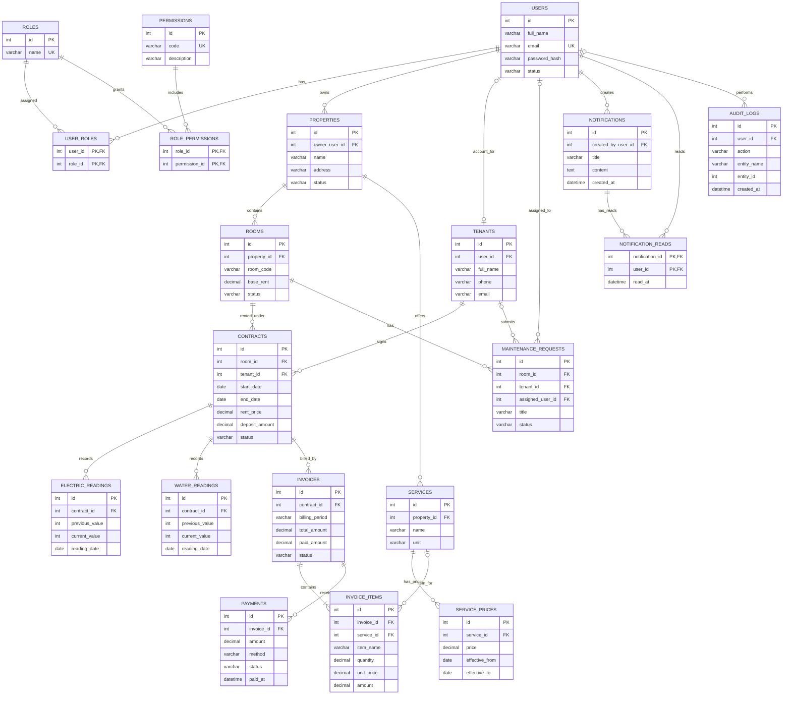

# Sơ đồ ERD – Hệ thống quản lý phòng trọ và nhà cho thuê

> Sơ đồ thiết kế đề xuất dựa trên danh sách Database Entity trong `DacTa.md` của dự án. Các khóa và quan hệ dưới đây là thiết kế logic đề xuất để hoàn thiện tài liệu; cần đối chiếu với schema/code thực tế trước khi triển khai.

## 1. Sơ đồ ERD

Ảnh sơ đồ: 

Sơ đồ Mermaid có thể chỉnh sửa trực tiếp trong GitHub:

## 2. Ý nghĩa các nhóm bảng

| Nhóm | Bảng | Mục đích |
|---|---|---|
| Tài khoản & phân quyền | `users`, `roles`, `permissions`, `user_roles`, `role_permissions` | Đăng nhập, gán vai trò và kiểm soát quyền truy cập. `role_permissions` là bảng liên kết đề xuất bổ sung để nối vai trò với quyền. |
| Nhà & phòng | `properties`, `rooms` | Quản lý nhà/khu trọ và các phòng thuộc từng khu. |
| Khách thuê & hợp đồng | `tenants`, `contracts` | Lưu hồ sơ khách thuê và lịch sử thuê phòng. |
| Dịch vụ | `services`, `service_prices` | Quản lý dịch vụ và lịch sử giá áp dụng theo thời gian. |
| Điện, nước | `electric_readings`, `water_readings` | Lưu chỉ số cũ/mới để tính mức tiêu thụ theo kỳ. |
| Hóa đơn & thanh toán | `invoices`, `invoice_items`, `payments` | Lập hóa đơn, tách các khoản thu và ghi nhận một hoặc nhiều lần thanh toán. |
| Sửa chữa | `maintenance_requests` | Theo dõi yêu cầu sửa chữa, người gửi và người được phân công. |
| Thông báo | `notifications`, `notification_reads` | Lưu thông báo và trạng thái đã đọc của từng người dùng. |
| Nhật ký hệ thống | `audit_logs` | Ghi lại hành động quan trọng để kiểm tra và truy vết. |

## 3. Quy tắc thiết kế cần lưu ý

1. Mỗi bảng nên có khóa chính (`PK`) để nhận diện bản ghi.
2. Khóa ngoại (`FK`) dùng để liên kết dữ liệu giữa các bảng.
3. Một phòng có thể có nhiều hợp đồng theo thời gian, nhưng cần quy tắc nghiệp vụ để không có hai hợp đồng `ACTIVE` cùng lúc cho một phòng.
4. Một hóa đơn có nhiều dòng chi tiết (`invoice_items`) và có thể có nhiều giao dịch thanh toán (`payments`) nếu cho phép trả nhiều lần.
5. Nên lưu giá dịch vụ theo thời gian trong `service_prices` để hóa đơn cũ không bị thay đổi khi giá mới được cập nhật.
6. Với hóa đơn, thanh toán và hợp đồng đã phát sinh, nên hạn chế xóa vật lý; ưu tiên trạng thái hoặc lưu vết.
7. Các kiểu dữ liệu, tên cột và quan hệ là đề xuất logic. Hãy đồng bộ chúng với quy ước tên, ORM và schema MySQL thực tế của dự án.

## 4. Cách thêm vào GitHub

- Đặt file này ở thư mục gốc hoặc trong thư mục `docs/` của repository.
- GitHub hỗ trợ hiển thị sơ đồ Mermaid trực tiếp trong Markdown. Mở `ERD_Database.md` trên GitHub để xem sơ đồ.
- Có thể chèn ảnh đã xuất bằng cú pháp: `` nếu bạn đặt file PNG cùng thư mục.
